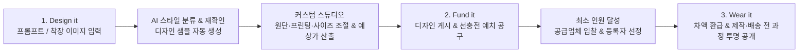

<div align="center">

# RE:FIT

### **Don't fit in. RE:FIT.**
**`Design it.` · `Fund it.` · `Wear it.`**

*세상의 기준에 맞추지 말고, 당신만의 핏을 만드세요.*

<br />


</div>

---

## Brand Identity

> **세상에 나를 맞추는 것이 아니라, 세상을 나에게 맞추다.**
>
> **RE:FIT**은 누구나 자신만의 의류를 디자인하고, 크라우드 펀딩을 통해 그 아이디어를 현실로 만들 수 있는 **AI 기반 패션 커스터마이징 플랫폼**입니다.
> 정해진 스타일에서 벗어나 자유롭게 디자인하고, 취향을 공유하며, 같은 개성을 추구하는 사람들과 새로운 패션을 만들어갑니다.
>
> **Don't fit in. RE:FIT.**

| 구분 | 내용 |
| :--- | :--- |
| **Brand Mission** · 브랜드 미션 | 누구나 패션의 소비자를 넘어 창작자가 될 수 있는 세상을 만든다. |
| **Brand Vision** · 브랜드 비전 | 개인의 개성과 창의성이 대중의 공감을 통해 실제 패션으로 탄생하는 생태계를 구축한다. |

### Core Values · 핵심 가치

| **Individuality** <br /> 개성과 정체성 | **Creativity** <br /> 창의성과 디자인 |
| :--- | :--- |
| **Customization** <br /> 자유로운 커스터마이징 | **Co-creation** <br /> 공감과 공동 창작 |

---

## Project Overview

| 항목 | 내용 |
| :--- | :--- |
| **프로젝트명** | **RE:FIT** *(가제)* |
| **팀 구성** | 최묘석, 윤형섭 (2인 1조) |
| **개발 기간** | 약 1개월 |
| **플랫폼 전략** | 웹(Web) 우선 개발 *(추후 네이티브 앱 확장 여부 결정)* |
| **기술 스택** | **Backend:** Django, DRF · **Frontend:** Vue.js, JS · **Design:** Figma · **AI:** RAG, AI Agent |
| **필수 구현 요소** | 회원 인증(로그인), 핵심 CRUD, AI 기능(RAG & AI Agent) |

---

## Service Flow — `Design it. Fund it. Wear it.`



---

## Key Features

### 1. Design it — AI 스타일 분석 & 인터랙티브 3D 커스텀 스튜디오
* **멀티모달 스타일 분석:** 텍스트 프롬프트 또는 착장 이미지(연예인, 모델, 본인 평소 착장 등)를 입력하면 락시크, 힙합, 스트릿, 모던, 캐주얼, 큐트 등 세분화된 스타일로 분류
* **스타일 재확인 *(검토 중)*:** *"이런 스타일의 옷을 원하시나요?"* 단계에서 스타일 예시 이미지를 제시해 사용자 의도를 확인하고 매칭 정확도 향상
* **디자인 샘플 자동 생성:** 확정된 스타일에 맞는 의류 디자인 샘플을 AI가 자동 생성
* **듀얼 커스텀 인터페이스:** 생성된 시안을 보며 **프롬프트 입력창**과 **세부 옵션 조절창**을 동시에 띄워 직관적으로 수정
* **의류 디자인 레거시 & 3D 구현:**
  * 저작권이 등록된 레거시 의류 디자인의 3D 구현
  * 의류 레거시 디자인 학습을 기반으로 사용자 프롬프트에 맞춘 의류 제작 지원
* **촉각적 3D 아틀리에 인터랙션 (뷰잉 · 채광 · 구김 시뮬레이션):**
  * **의류 자체 360° 회전 & 부위 포커스 줌:** 조명을 고정한 채 옷 자체를 360° 궤도/턴테이블 회전하거나 정면·등판·후드·프린팅 영역을 원클릭 클로즈업 확인 *(광원 회전과 독립 분리 제어)*
  * **5대 환경·채광 360° 시뮬레이션:** `스튜디오` · `자연광` · `일반 형광등` · `밤거리` · `가로등` 프리셋 전환 및 광원 360° 회전으로 조명별 색감 차이(메타머리즘) 사전 검증
  * **부위 지정 구겨보기(Crumple) & 펴보기(Smooth):** 소매·후드·밑단 등 원하는 부위를 마우스로 직접 집어 구기거나 다림질하듯 펴보며 원단별 탄성 복원력·잔주름 질감 확인
  * **촉각 연동 원단 마찰 사운드:** 드래그 조작 속도에 맞춰 소재별(면 스침음, 나일론 바스락거림 등) 실시간 음향 피드백 재생
* **정밀 세부 커스터마이징 & 예상 제작가 산출:**
  * **의류 종류:** 티셔츠, 맨투맨, 후드티, 바람막이, 패딩, 코트 등
  * **파츠 & 이중 원단:** 빅 후드/포켓/시보리 모듈 선택, **겉감 + 안감 이중 원단 덧댐**, 부위별 컬러 배색
  * **질감 / 재질:** 원단 재질, 원단 두께, 구김 정도, 옷 주름, 무게(`gsm`)
  * **프린팅 & 컬러:** 2차 창작 가능한 각종 폰트, 글씨를 로고로 디자인화하는 기능 *(검토 중)*, 곡면 데칼 드래그 배치 및 색상 커스텀
  * **사이즈 조절:** 어깨, 허리, 기장 등 세부 치수 및 **XS ~ 3XL** 전 사이즈 디자인·체형 비율 실시간 자동 적용
  * **예상 제작가격 산출:** 선택한 원단·공정·디자인 스펙에 따라 예상 제작 단가를 실시간 계산

#### 3D 인터랙티브 스튜디오 적용 기술 스택

| 기능 영역 | 핵심 기술 스택 / 모듈 | 세부 역할 |
| :--- | :--- | :--- |
| **UI · 상태 동기화** | `Vue 3`, `Pinia`, `Vite` | AI 프롬프트·세부 옵션 패널과 3D 뷰포트 간 실시간 상태 연동 |
| **360° 회전 · 커스텀 변형** | `OrbitControls`, `GLTFLoader`, `DRACOLoader`, Morph Targets, `DecalGeometry` | 의류 360° 궤도/턴테이블 회전·부위 포커스 줌, XS~3XL 체형 변형, 파츠 교체 및 로고 데칼 투영 |
| **원단 광학 렌더링** | `Three.js (r170)`, `MeshPhysicalMaterial`, `AgXToneMapping` | 면·기모 미세모 산란(`sheen`), 나일론·패딩 코팅광(`clearcoat`) 및 야간 조명 색보정 |
| **360° 채광 시뮬레이션** | `RGBELoader` (HDRI IBL), `scene.environmentRotation`, `Directional/SpotLight` | 5종 환경광 360° 회전(면광 반사) 및 프리셋별 주광원 소프트 그림자 분리 처리 |
| **부위 피킹 · 거시 구김** | `three-mesh-bvh`, Welded Vertex Spring Engine | 0.1ms 고속 부위 검출(`boundsTree.refit()`) 및 봉제선(UV Seam) 균열 방지 탄성 변형 |
| **미세 잔주름 · 프린팅** | `onBeforeCompile` (GLSL), `CanvasTexture`, `DecalGeometry` | 구겨진 부위에만 Whiteout 이중 노멀·Micro-AO 합성 및 프린팅·로고 실시간 투영 |
| **촉각 사운드 피드백** | `Web Audio API` (`BiquadFilterNode`) | 드래그 속도 연동 소재별 주파수 대역 필터링 원단 마찰음 실시간 합성 |

#### 3D 스튜디오 필수 에셋 규격 및 조달 계획

| 에셋 분류 | 권장 기술 규격 | 확보 경로 (CC0 / 자체 제작) |
| :--- | :--- | :--- |
| **3D 의류 베이스 모델** | `.glb` (Draco 압축), 균일 Quad 토폴로지, 의류당 8k~20k Tris, 파츠 분리 및 비중첩 UV | Blender 리토폴로지, Sketchfab (CC0), CLO3D 샘플 |
| **원단 직조 PBR 맵** | 1K~2K 심리스 타일링 세트 (`Albedo`, `Normal`, `Roughness`, `AO`) | ambientCG, Poly Haven Textures, ShareTextures (CC0) |
| **구김 전용 디테일 맵** | 소재군별 고주파 주름 맵 (굵은 면 주름용 / 나일론 크링클용 `Wrinkle Normal` + `Cavity AO`) | Blender Sculpt 베이킹 및 절차적 노이즈 생성 |
| **5종 채광 환경맵** | 1K `.hdr` — 스튜디오, 자연광, 실내 형광등, 밤거리, 가로등 | Poly Haven HDRIs (CC0) + 실시간 조명 리그 보정 |
| **아틀리에 소품 · 사운드** | 저폴리곤 마네킹/작업대 배경 메쉬 및 원단 마찰 폴리·합성 사운드 | Web Audio API 실시간 합성 + Freesound (CC0) |


### 2. Fund it — 커뮤니티 & 크라우드 펀딩형 공동구매
1벌 단독 제작 시 맞춤 정장 수준으로 높아지는 단가 문제를 **커뮤니티 기반 크라우드 펀딩 공구**로 해결합니다.

* **디자인 게시판 (CRUD):** 커스텀한 의류 디자인 시안 등록·조회·수정·삭제
* **소셜 기능:** 디자인 시안 좋아요, 제작자 팔로우
* **디자인 이용권 거래:** 타인이 공개된 디자인을 활용하고 싶을 때 이용권을 구매하여 사용
* **선충전(예치금) 기반 구매 예정 확정:** 캐시를 미리 충전하듯 산출된 예상 제작가격보다 소폭 넉넉한 금액으로 구매 예정을 확정
* **얼리버드 수수료 감면:** 디자인 등록 후 **1주일 이내 참여 시 플랫폼 수수료(서비스 사용료) 감면**

### 3. Wear it — 공급업체 입찰 & 투명한 제작·배송 추적
* **공급업체 입찰 오픈:** 최소 구매 예정자 수 돌파 시 공급업체 입찰 가능
* **공급업체 선정 & 차액 환급:** 디자인 등록자가 입찰 업체 중 최종 선택하며, 낙찰 단가가 예상 제작가보다 낮을 경우 **차액을 포인트 또는 캐시로 환급**
* **전 과정 투명 공개:** 공급업체 선정 이후 **제작 → 검수 → 발송**까지의 전 과정을 구매 예정자에게 투명하게 공개

#### 진행 시나리오 예시 (후드티)

| 단계 | 내용 |
| :--- | :--- |
| **1. 커스텀 작성** | 후드티 · 단단한 소재(큰 후드) · 안감 면 + 겉감 원단 이중 덧댐 |
| **2. 예상가 산출 및 등록** | 예상 제작가격 **70,000원** 산출 → 플랫폼에 디자인 등록 |
| **3. 구매 예정 확정** | 참여자는 예상가보다 높은 **85,000원**으로 예치·확정 *(등록 후 1주일 이내 수수료 감면)* |
| **4. 최소 인원 달성** | 구매 예정자 **100명 이상** 돌파 시 공급업체 입찰 오픈 |
| **5. 공급업체 선정 및 정산** | 디자인 등록자가 공급업체 선택 *(낙찰가 < 예상가 70,000원 시 차액 포인트/캐시 환급)* |
| **6. 제작 및 배송 공개** | 공급업체 선정 후 제작부터 발송까지 전 과정 실시간 투명 공개 |

---

## Copyright & Business Model

* **저작권 정책:** 본 서비스로 생성된 모든 디자인의 저작권은 서비스 제공자(플랫폼)에 귀속되며, 상업적 사용 및 실물 제작(퍼블리싱) 시 이용료를 부과합니다.
* **수익 구조 (BM):**
  1. **디자인 이용권 거래 수수료:** 공개된 디자인의 이용권 구매 시 발생하는 플랫폼 수수료 *(제작자 수익 + 플랫폼 수수료)*
  2. **공동구매 중개 수수료:** 공구 참여 및 실물 제작 진행 시 부과되는 서비스 사용료 *(등록 1주일 이내 얼리버드 감면 적용)*

---

## Technical Challenges & Risk Management

| 영역 | 주요 과제 및 대응 방향 |
| :--- | :--- |
| **레퍼런스 확보 & 초상권** | 세분화된 모든 스타일의 예시 사진 확보 방안 수립. 외부 크롤링 시 발생하는 초상권·저작권·사진 활용 권한 리스크 대응 |
| **AI 매칭 & 할루시네이션** | 입력 이미지/프롬프트와 스타일 분류 간 매칭 정확도를 높이고, RAG 및 구조화된 출력(Structured Output)으로 할루시네이션 제어 |
| **상표권 / 위조품(짝퉁) 방지** | Supreme, Louis Vuitton 등 유명 브랜드 로고·상표는 **1차로 AI가 인식해 생성 단계에서 차단**하고, 우회 생성 시 **2차로 주기적 탐지 및 삭제** 정책 운영 |

---

## Documentation & Project Structure

* [System Architecture](./docs/ARCHITECTURE.md) — 전체 아키텍처, SSAFY GMS Multi-Agent/RAG 파이프라인, 3D 스튜디오, 정산 시퀀스
* [ERD & Database Schema](./docs/ERD.md) — PostgreSQL + `pgvector` ERD 및 전체 테이블 명세
* [API Specification](./docs/API_SPEC.md) — REST API (`/api/v1`) 및 WebSocket (`/ws/campaigns/`) 명세
* [3D Interactive Studio Spec (PDF)](./docs/RE_FIT_3D_Interactive_Studio_Spec.pdf) — 360° 환경 채광 시뮬레이션 및 부위 지정 원단 구김·펴기 인터랙션 기술 명세 및 검증서
* [Figma UI Frames & Design Guide](./docs/figma/README.md) — Figma에 바로 드래그 앤 드롭 가능한 `1440×900` 레이어 분리형 `.svg` 화면 프레임 3종 및 디자인 토큰 명세

```text
re-fit/
├── docs/               # Architecture, ERD, API Spec
├── backend/            # Django + DRF + Channels + Celery + SSAFY GMS AI Engine
│   ├── config/
│   └── apps/           # accounts, ai_engine, designs, payments, funding
├── frontend/           # Vue 3 + Vite + Pinia + Three.js 3D Studio
└── docker-compose.yml  # PostgreSQL (pgvector) + Redis
```

### Quick Start
```bash
# 1. Backend
cd backend
cp .env.example .env   # GMS_API_KEY 등 환경변수 입력
pip install -r requirements.txt
python manage.py makemigrations && python manage.py migrate
python manage.py runserver

# 2. Frontend
cd frontend
npm install
npm run dev
```

---

<div align="center">

**RE:FIT** — *Don't fit in. RE:FIT.* · *Design it. Fund it. Wear it.*

</div>
