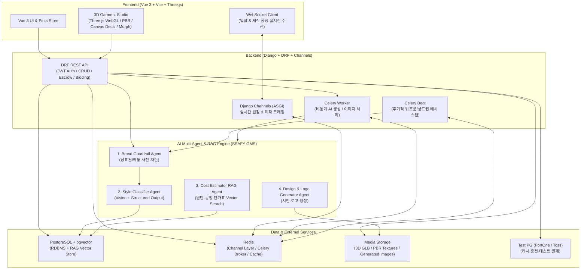
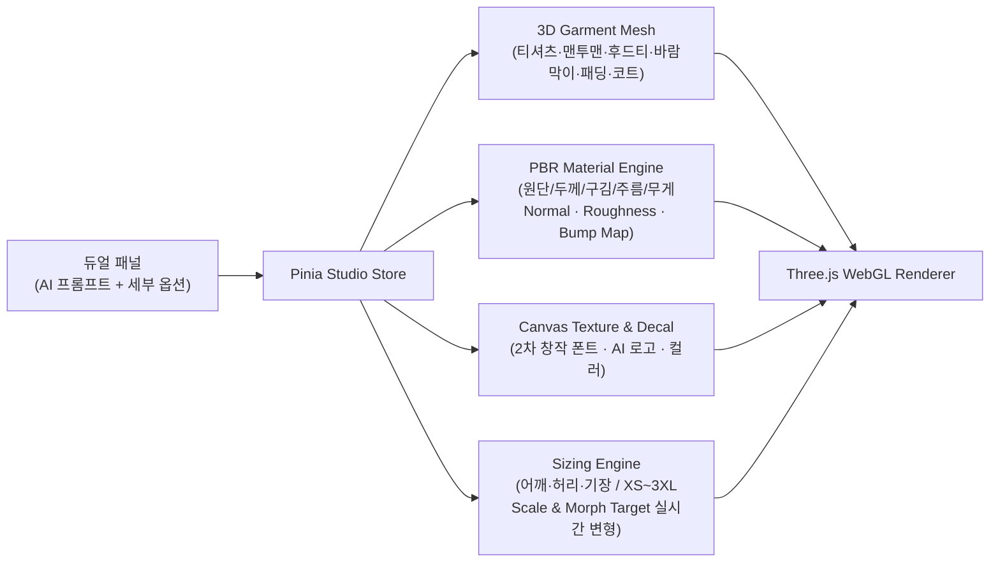
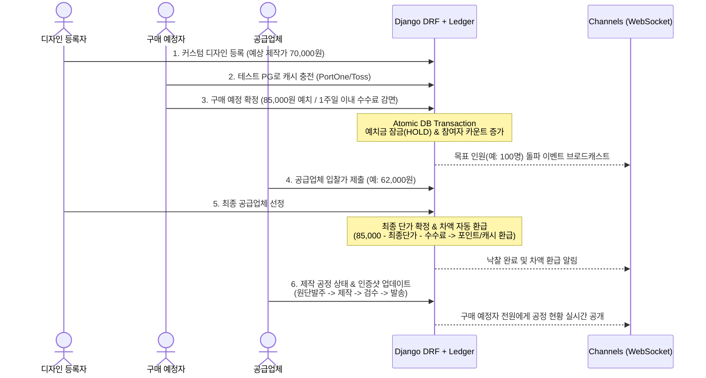

# RE:FIT System Architecture

> **Don't fit in. RE:FIT.** · **`Design it. Fund it. Wear it.`**

본 문서는 **RE:FIT**의 전체 시스템 아키텍처, AI Multi-Agent + RAG 파이프라인, 3D 커스텀 스튜디오 구조, 그리고 크라우드 펀딩 정산/실시간 공정 트래킹 설계를 정의합니다.

---

## 1. High-Level Architecture

---

## 2. AI Multi-Agent & RAG Pipeline (SSAFY GMS)

모든 LLM / Vision / Embedding / Image Generation 호출은 **SSAFY GMS Gateway**를 통해 통합 관리합니다.
* **환경변수 분리:** `GMS_API_KEY`, `GMS_BASE_URL`은 `.env`로 관리하며, 개발/테스트 시 `AI_MOCK_MODE=True`로 전환하여 API 비용 없이 전체 파이프라인을 검증할 수 있습니다.

### 2.1. Multi-Agent 역할 분담

| Agent | 입력 | 처리 방식 | 출력 |
| :--- | :--- | :--- | :--- |
| **Brand Guardrail Agent** | 프롬프트 / 업로드 이미지 / 게시물 시안 | 유명 브랜드(Supreme, Louis Vuitton 등) 로고·텍스트·유사 패턴 탐지 (1차 사전 차단 + 2차 Celery Beat 주기적 스캔) | `is_safe: bool`, `risk_score`, `blocked_brands[]`, `reason` |
| **Style Classifier Agent** | 텍스트 프롬프트 또는 착장 이미지 | Vision LLM + **Structured Output(JSON Schema)**으로 고정된 스타일 Taxonomy 중 Top-3 분류 → DB의 사전 큐레이션 레퍼런스 카드 매칭 | `top_styles[]` (스타일 ID, 확신도, 레퍼런스 이미지 URL, 추출 속성 태그) |
| **Design & Logo Generator Agent** | 확정 스타일 + 커스텀 옵션(원단·컬러·핏) + 텍스트 | 2D 디자인 시안 이미지 생성 및 텍스트 → 로고 그래픽 생성(투명 배경 PNG, 3D 의류 데칼 부착용) | `preview_image_url`, `logo_decal_url`, `prompt_used` |
| **Cost Estimator RAG Agent** | 의류 종류, 원단(안감/겉감/이중 덧댐), 두께, 프린팅 면적, 목표 수량 | `pgvector`에 인덱싱된 **원단·부자재·공임 단가표**를 RAG 검색하여 근거 기반 견적 산출 | `estimated_price`, `breakdown` (원단비/부자재비/공임비/마진), `rag_sources[]` |

### 2.2. 할루시네이션 & 저작권/초상권 통제 전략
1. **초상권 원천 차단:** 외부 크롤링 대신 자체 생성한 **고스트 마네킹 / 플랫레이 / 크롭 룩북** 레퍼런스 DB를 구축해 스타일 재확인 단계에 노출합니다.
2. **할루시네이션 방지:** 스타일 분류 시 자유 텍스트 생성을 금지하고, DB에 등록된 `StyleCategory` ID 목록 내에서만 선택하도록 **JSON Schema Structured Output**을 강제합니다.
3. **Human-in-the-Loop:** *"이런 스타일의 옷을 원하시나요?"* 단계에서 사용자가 스타일 후보와 속성 태그를 직접 확정/보정한 뒤 디자인 생성으로 넘어가도록 설계합니다.

---

## 3. Frontend 3D Customization Studio (`Vue 3 + Three.js`)

* **실시간 듀얼 인터페이스:** 좌측 3D WebGL 캔버스와 우측 AI 프롬프트 + 세부 스펙 조절 패널을 동시에 배치합니다.
* **의류 레거시 3D 지원:** 저작권 등록 레거시 의류/유니폼 3D `.glb` 베이스 모델을 로드하고, 프롬프트 기반 커스텀 결과를 텍스처·머티리얼·사이즈 파라미터로 즉시 적용합니다.

---

## 4. Crowdfunding, Escrow & Real-Time Tracking Flow

---

## 5. Security & Integrity Principles
* **금융 원장 무결성:** 모든 충전·예치·이용권 결제·차액 환급은 `transaction.atomic()`과 `select_for_update()` 기반의 불변 원장(`LedgerTransaction`)으로 기록합니다.
* **API 키 보호:** SSAFY GMS 키, PG 시크릿 키, Django `SECRET_KEY`는 `.env`로 분리하며 절대 저장소에 커밋하지 않습니다.
* **저작권 명시:** 서비스로 생성된 모든 디자인의 저작권 귀속 및 상업적 이용권 정책을 디자인 등록·이용권 구매 API 단계에서 검증합니다.
