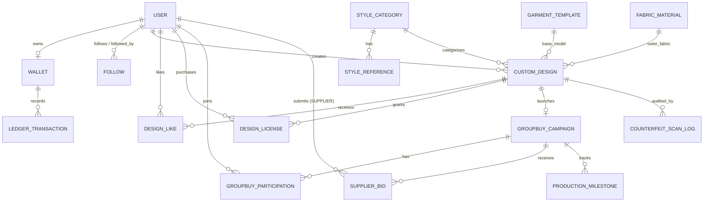

# RE:FIT ERD & Database Schema

본 문서는 **RE:FIT**의 데이터베이스 설계(PostgreSQL + `pgvector`)와 핵심 테이블 명세를 정의합니다.

---

## 1. Entity-Relationship Diagram (ERD)

---

## 2. Core Tables Specification

### 2.1. Accounts & Social (`apps/accounts`)

#### `users` (Custom User Model)
| Column | Type | Constraints | Description |
| :--- | :--- | :--- | :--- |
| `id` | BigInt | PK | 사용자 ID |
| `email` | Varchar(255) | UNIQUE, NOT NULL | 로그인 이메일 |
| `username` | Varchar(50) | UNIQUE, NOT NULL | 닉네임 / 브랜드명 |
| `password` | Varchar(255) | NOT NULL | 해시 비밀번호 |
| `role` | Varchar(20) | NOT NULL, DEFAULT `'USER'` | `USER` (일반/디자이너), `SUPPLIER` (공급업체), `ADMIN` |
| `company_name` | Varchar(100) | NULL | 공급업체 상호명 |
| `business_reg_no` | Varchar(30) | NULL | 공급업체 사업자등록번호 |
| `profile_image` | Varchar(500) | NULL | 프로필 이미지 URL |
| `bio` | Text | NULL | 소개글 |
| `created_at` | Timestamp | NOT NULL | 가입일시 |

#### `follows`
| Column | Type | Constraints | Description |
| :--- | :--- | :--- | :--- |
| `id` | BigInt | PK | 팔로우 ID |
| `follower_id` | BigInt | FK → `users.id` | 팔로우 하는 유저 |
| `following_id` | BigInt | FK → `users.id` | 팔로우 대상 제작자 |
| `created_at` | Timestamp | NOT NULL | 생성일시 (UNIQUE: `follower_id`, `following_id`) |

---

### 2.2. AI Style & Garment Catalog (`apps/designs`, `apps/ai_engine`)

#### `style_categories` (고정 스타일 Taxonomy)
| Column | Type | Constraints | Description |
| :--- | :--- | :--- | :--- |
| `id` | BigInt | PK | 스타일 ID |
| `parent_category` | Varchar(50) | NOT NULL | 대분류 (`STREET`, `MODERN`, `ROCK_CHIC`, `HIPHOP`, `CASUAL`, `CUTE` 등) |
| `name` | Varchar(80) | UNIQUE, NOT NULL | 세부 스타일명 (예: `고프코어`, `미니멀`, `빈티지 스트릿`) |
| `keywords` | JSONB | NOT NULL | 대표 무드/실루엣 키워드 리스트 |
| `embedding` | Vector(1536) | NULL | `pgvector` 스타일 임베딩 벡터 |

#### `style_references` (사전 생성/큐레이션 레퍼런스 DB)
| Column | Type | Constraints | Description |
| :--- | :--- | :--- | :--- |
| `id` | BigInt | PK | 레퍼런스 ID |
| `style_id` | BigInt | FK → `style_categories.id` | 소속 스타일 |
| `image_url` | Varchar(500) | NOT NULL | 초상권 이슈 없는 사전 생성/라이선스 안전 예시 이미지 |
| `tags` | JSONB | NOT NULL | 착장 속성 태그 (핏, 컬러, 소재 등) |

#### `garment_templates` (3D 의류 베이스 & 레거시 디자인)
| Column | Type | Constraints | Description |
| :--- | :--- | :--- | :--- |
| `id` | BigInt | PK | 템플릿 ID |
| `garment_type` | Varchar(30) | NOT NULL | `TSHIRT`, `SWEATSHIRT`, `HOODIE`, `WINDBREAKER`, `PADDING`, `COAT`, `UNIFORM` |
| `name` | Varchar(100) | NOT NULL | 템플릿명 (예: `헤비웨이트 오버핏 후드티`, `레거시 야구 유니폼`) |
| `is_legacy_copyrighted` | Boolean | DEFAULT `False` | 저작권 등록 레거시 의류 여부 |
| `model_glb_url` | Varchar(500) | NOT NULL | Three.js 3D `.glb` 모델 경로 |
| `base_labor_cost` | Int | NOT NULL | 기본 공임비 (원) |
| `size_chart` | JSONB | NOT NULL | `XS`~`3XL` 어깨/허리/기장 기준 치수 및 3D 스케일 파라미터 |

#### `fabric_materials` (원단 & RAG 단가 지식 베이스)
| Column | Type | Constraints | Description |
| :--- | :--- | :--- | :--- |
| `id` | BigInt | PK | 원단 ID |
| `name` | Varchar(100) | NOT NULL | 원단명 (예: `헤비 면 480g`, `립스톱 나일론`, `양면 기모`) |
| `gsm_weight` | Int | NOT NULL | 원단 무게 (g/m²) |
| `thickness_level` | Int | NOT NULL | 두께 단계 (1~5) |
| `wrinkle_level` | Int | NOT NULL | 구김 정도 (1~5) |
| `cost_per_unit` | Int | NOT NULL | 벌당 원단 단가 (원) |
| `pbr_textures` | JSONB | NOT NULL | Three.js PBR 맵 (`albedo`, `normal`, `roughness`, `bump`) |
| `embedding` | Vector(1536) | NULL | RAG 검색용 원단 설명 임베딩 |

---

### 2.3. Custom Designs & Community (`apps/designs`)

#### `custom_designs`
| Column | Type | Constraints | Description |
| :--- | :--- | :--- | :--- |
| `id` | BigInt | PK | 디자인 ID |
| `creator_id` | BigInt | FK → `users.id` | 제작자 |
| `template_id` | BigInt | FK → `garment_templates.id` | 의류 베이스 템플릿 |
| `style_id` | BigInt | FK → `style_categories.id`, NULL | AI 분석 스타일 |
| `outer_fabric_id` | BigInt | FK → `fabric_materials.id` | 겉감 원단 |
| `inner_fabric_id` | BigInt | FK → `fabric_materials.id`, NULL | 안감 원단 (이중 덧댐 등) |
| `title` | Varchar(150) | NOT NULL | 디자인 제목 |
| `description` | Text | NOT NULL | 디자인 설명 |
| `prompt_history` | JSONB | NOT NULL | AI 프롬프트 및 수정 이력 |
| `custom_spec` | JSONB | NOT NULL | 3D/세부 스펙 (색상, 후드 크기, 이중 덧댐, 구김, 주름, 프린팅/폰트/로고 좌표, 사이즈 치수) |
| `preview_image_url` | Varchar(500) | NOT NULL | 대표 2D/3D 렌더링 이미지 |
| `estimated_cost` | Int | NOT NULL | RAG 산출 예상 제작가격 (예: 70,000원) |
| `cost_breakdown` | JSONB | NOT NULL | 원단비/부자재비/공임비 상세 견적 |
| `license_price` | Int | DEFAULT `0` | 타인 디자인 이용권 가격 |
| `copyright_owner` | Varchar(50) | DEFAULT `'RE:FIT'` | 저작권 귀속 주체 (플랫폼 정책) |
| `status` | Varchar(20) | DEFAULT `'PUBLISHED'` | `DRAFT`, `PUBLISHED`, `BLINDED` (위조품 차단) |
| `like_count` | Int | DEFAULT `0` | 좋아요 캐시 카운트 |
| `created_at` | Timestamp | NOT NULL | 등록일시 (얼리버드 1주일 기준점) |

#### `design_likes` & `design_licenses`
* `design_likes`: `(id, user_id, design_id, created_at)` — UNIQUE `(user_id, design_id)`
* `design_licenses`: `(id, design_id, buyer_id, paid_amount, platform_fee, creator_payout, created_at)` — 상업적/2차 디자인 이용권 구매 및 수수료 정산 내역

---

### 2.4. Crowdfunding, Bidding & Tracking (`apps/funding`)

#### `groupbuy_campaigns` (공구 캠페인)
| Column | Type | Constraints | Description |
| :--- | :--- | :--- | :--- |
| `id` | BigInt | PK | 캠페인 ID |
| `design_id` | BigInt | UNIQUE, FK → `custom_designs.id` | 대상 디자인 |
| `min_participants` | Int | NOT NULL, DEFAULT `100` | 최소 구매 예정자 수 (데모 시 조정 가능) |
| `current_participants` | Int | NOT NULL, DEFAULT `0` | 현재 참여자 수 |
| `estimated_unit_cost` | Int | NOT NULL | 예상 제작가격 (예: 70,000원) |
| `deposit_price` | Int | NOT NULL | 구매 예정 확정 예치금 (예: 85,000원) |
| `early_bird_deadline` | Timestamp | NOT NULL | 수수료 감면 마감일 (`created_at + 7 days`) |
| `selected_bid_id` | BigInt | FK → `supplier_bids.id`, NULL | 최종 선정된 공급업체 입찰 |
| `final_unit_cost` | Int | NULL | 확정 제작 단가 |
| `status` | Varchar(30) | NOT NULL | `RECRUITING`, `BIDDING_OPEN`, `SUPPLIER_SELECTED`, `IN_PRODUCTION`, `SHIPPED`, `COMPLETED`, `CANCELED` |
| `created_at` | Timestamp | NOT NULL | 생성일시 |

#### `groupbuy_participations` (구매 예정 확정)
| Column | Type | Constraints | Description |
| :--- | :--- | :--- | :--- |
| `id` | BigInt | PK | 참여 ID |
| `campaign_id` | BigInt | FK → `groupbuy_campaigns.id` | 캠페인 |
| `user_id` | BigInt | FK → `users.id` | 구매 예정자 |
| `selected_size` | Varchar(10) | NOT NULL | `XS`, `S`, `M`, `L`, `XL`, `2XL`, `3XL` |
| `quantity` | Int | DEFAULT `1` | 수량 |
| `deposit_amount` | Int | NOT NULL | 예치 금액 (예: 85,000원) |
| `service_fee` | Int | NOT NULL | 플랫폼 수수료 (얼리버드 기간 감면 적용) |
| `is_early_bird` | Boolean | NOT NULL | 등록 후 1주일 이내 참여 여부 |
| `refunded_amount` | Int | DEFAULT `0` | 최종 단가 확정 후 환급된 차액 |
| `status` | Varchar(20) | NOT NULL | `RESERVED`, `SETTLED`, `REFUNDED`, `CANCELED` |
| `created_at` | Timestamp | NOT NULL | 참여일시 |

#### `supplier_bids` (공급업체 입찰)
| Column | Type | Constraints | Description |
| :--- | :--- | :--- | :--- |
| `id` | BigInt | PK | 입찰 ID |
| `campaign_id` | BigInt | FK → `groupbuy_campaigns.id` | 대상 캠페인 |
| `supplier_id` | BigInt | FK → `users.id` | 공급업체 유저 (`role='SUPPLIER'`) |
| `proposed_unit_cost` | Int | NOT NULL | 제안 제작 단가 (원) |
| `estimated_lead_days` | Int | NOT NULL | 예상 제작 소요일 |
| `proposal_note` | Text | NOT NULL | 원단 수급 및 제작 제안서 |
| `is_selected` | Boolean | DEFAULT `False` | 최종 낙찰 여부 |
| `created_at` | Timestamp | NOT NULL | 입찰일시 |

#### `production_milestones` (투명한 제작~발송 트래킹)
| Column | Type | Constraints | Description |
| :--- | :--- | :--- | :--- |
| `id` | BigInt | PK | 공정 로그 ID |
| `campaign_id` | BigInt | FK → `groupbuy_campaigns.id` | 대상 캠페인 |
| `stage` | Varchar(30) | NOT NULL | `SUPPLIER_MATCHED`, `FABRIC_ORDERED`, `SEWING`, `PRINTING`, `QUALITY_CHECK`, `SHIPPED`, `DELIVERED` |
| `title` | Varchar(120) | NOT NULL | 단계 제목 |
| `description` | Text | NOT NULL | 상세 진행 내용 |
| `evidence_image_url` | Varchar(500) | NULL | 공장/검수/송장 인증 사진 |
| `created_at` | Timestamp | NOT NULL | 업데이트 일시 |

---

### 2.5. Wallet, PG & Anti-Counterfeit (`apps/payments`, `apps/ai_engine`)

#### `wallets` & `ledger_transactions`
* `wallets`: `(id, user_id, cash_balance, point_balance, updated_at)`
* `ledger_transactions`: `(id, wallet_id, tx_type, amount, balance_after, pg_tid, reference_type, reference_id, note, created_at)`
  * `tx_type`: `PG_CHARGE`, `DEPOSIT_HOLD`, `DIFF_REFUND_POINT`, `DIFF_REFUND_CASH`, `LICENSE_PURCHASE`, `LICENSE_PAYOUT`, `PLATFORM_FEE`

#### `counterfeit_scan_logs` (상표권/짝퉁 방지 이력)
* `(id, design_id, scan_type['PRE_GEN'|'PERIODIC_BATCH'], is_flagged, detected_brands, confidence, action_taken, scanned_at)`
